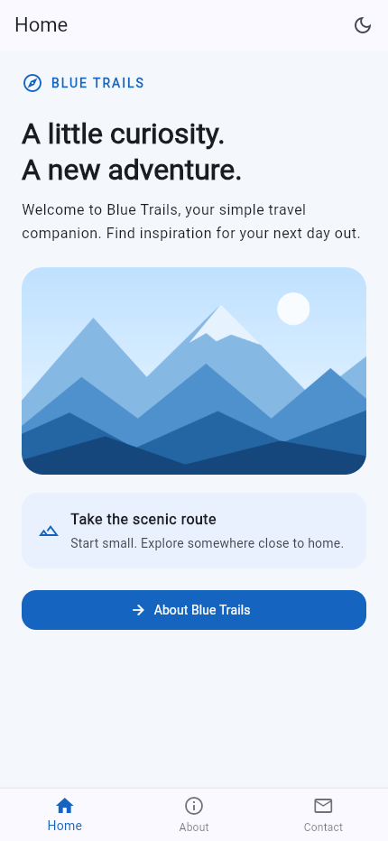
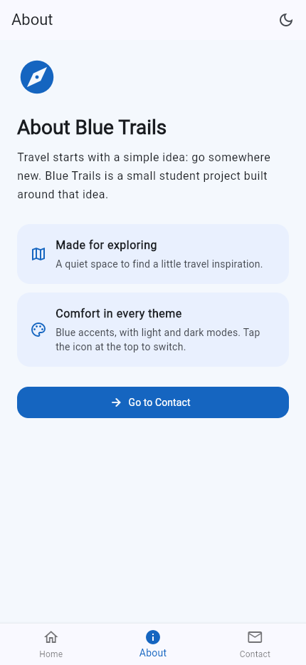
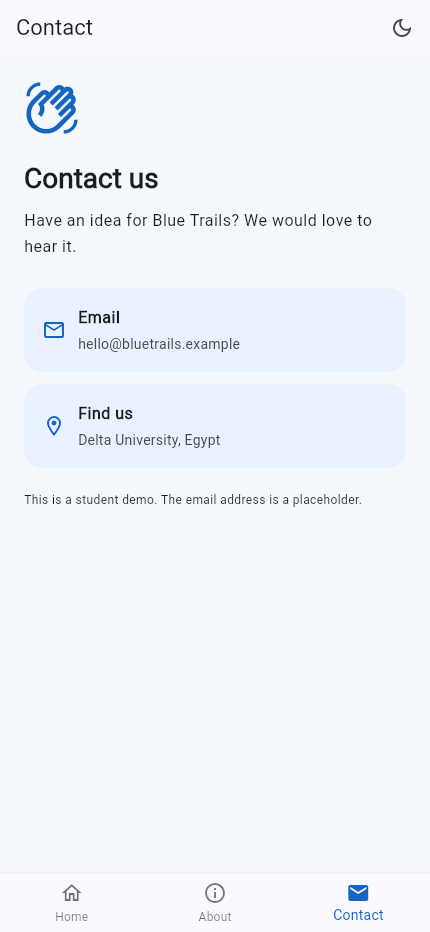
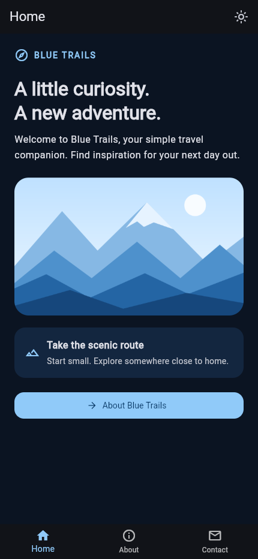
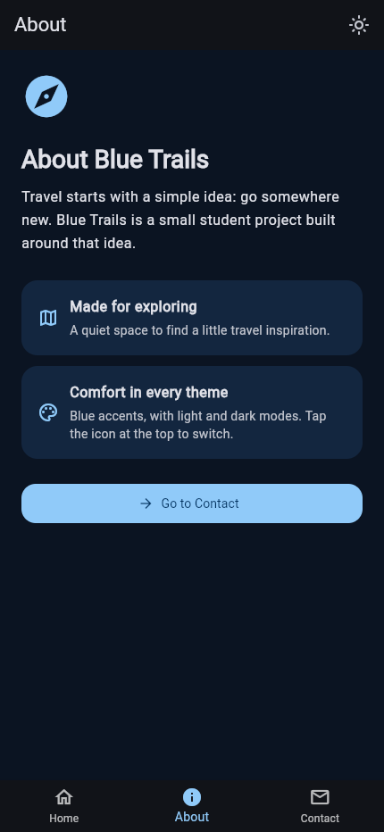
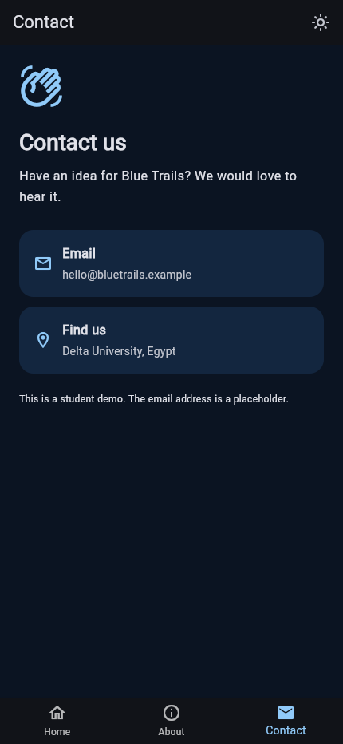

# Blue Trails

A simple Flutter travel app with Home, About, and Contact pages, bottom navigation, and blue-accented light and dark themes.

## Features

- Home page with a bundled mountain illustration.
- About and Contact pages with Material icons.
- Buttons to navigate from Home to About and from About to Contact.
- Bottom navigation to switch between all three pages.
- Light and dark themes that follow the system setting, with an app bar toggle.
- Scrollable layouts for smaller screens.

## Screenshots

### Light theme

<p>
  
  
  
</p>

### Dark theme

<p>
  
  
  
</p>

## Getting started

Install [Flutter](https://docs.flutter.dev/get-started/install) 3.27 or newer and a supported browser, then clone the repository:

```sh
git clone https://github.com/cybernovainc/blue-trails.git
cd blue-trails
flutter pub get
flutter run -d chrome
```

To use Microsoft Edge, run `flutter run -d edge` instead.

## Project structure

```text
lib/
  main.dart                 App shell, navigation, and themes
  pages/                    Home, About, and Contact pages
  widgets/                  Shared layout and information widgets
assets/images/              Bundled Home illustration
test/                       Navigation and theme widget test
web/                        Web entry point
```

## Testing

```sh
flutter analyze
flutter test
```

The widget test checks page navigation and switching between light and dark themes.

## Build for web

```sh
flutter build web
```

The output is generated in `build/web`.

The Contact page uses a placeholder email address for demonstration.
